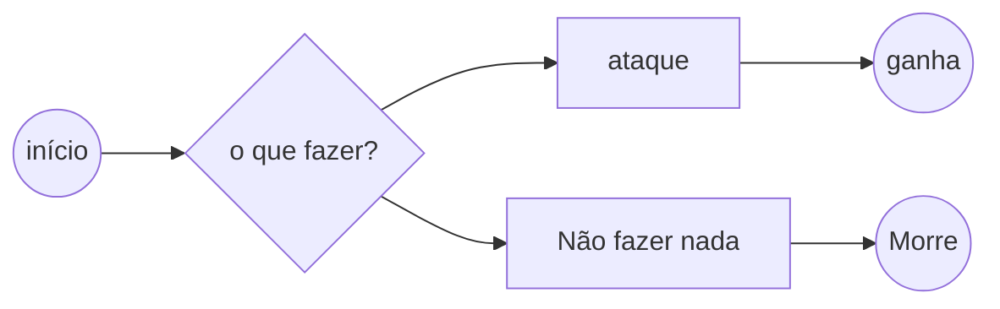
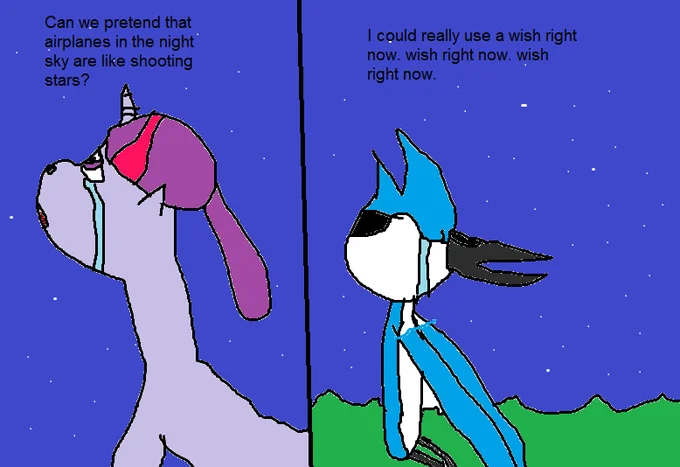

# Persona 3

Persona 3 Reload situa-se no vale da amoreira, onde o nosso protagonista Luva di Nike (Telmo Loko) perde-se pelas ruas da amoreira e encontra o Tiago Grila e acaba alvejando a si próprio, por surpresa de Luva di Nike, não morreu e acordou num sitio misterioso, Luva de Nike encontrava-se na Escola Básica Quinta nova da Telha!!

### Walkthrough

Persona 3 Reload é um jogo turned based jrpg com um mundo semi-aberto que permite alguma exploração livre mas nada fora dos limites da história

### Estratégia

#### personagens
### Personagens e itens
* luva de nike

.jpg>)
* Tiago Grila

* Camila Loures

* Hutao gexinpact

* Anitta

#### Itens

* Nike
* Glock
* Placa do YT - Camila Loures
* Caixão
* Mini short rasgado ganga

### Historia
Retrata a história de um estudante que se junta à S.E.E.S., um grupo de jovens capazes de invocar Personas.
Juntos, eles exploram a torre Tartarus durante a Hora Sombria, a vigésima quinta hora do dia que so usuarios de Persona conseguem perceber, que surge entre a meia-noite e uma da manhã cheio de monstros chamados Shadows. O objetivo inicial de eliminar essa ameaça transforma-se em uma missão desesperada para impedir Nyx, um ser que planeia destruir mundo.

#### representação:

* combat scene

* momento emocional

* unrelated kda a farmar aura

### Link úteis

[Genshin site](https://genshin.hoyoverse.com/)

[Combatchy](https://share.google/vwroT3SIw5TE9e05e)

[Persona 3](https://share.google/cP6hQg8QBTKTr50cu)

[Camila Loures](https://share.google/zfcayk9G1Q5bbz3hk)

[Jogo do Tiago Grila](https://store.steampowered.com/app/3191050/BRAZILIAN_DRUG_DEALER_3_I_OPENED_A_PORTAL_TO_HELL_IN_THE_FAVELA_TRYING_TO_REVIVE_MIT_AIA_I_NEED_TO_CLOSE_IT/)
