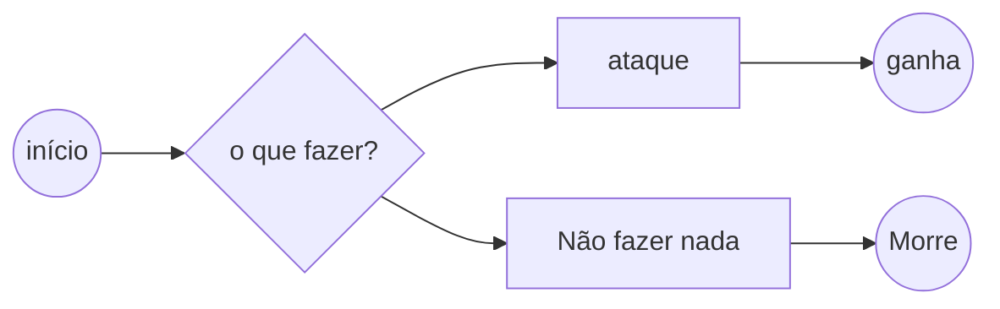

# Persona 3

Persona 3 Reload situa-se no vale da amoreira, onde o nosso protagonista Luva di Nike (Telmo Loko) perde-se pelas ruas da amoreira e encontra o Tiago Grila e acaba alvejando a si próprio, por surpresa de Luva di Nike, não morreu e acordou num sitio misterioso, Luva de Nike encontrava-se na Escola Básica Quinta nova da Telha!!

### Walkthrough

Persona 3 Reload é um jogo turned based jrpg com um mundo semi-aberto que permite alguma exploração livre mas nada fora dos limites da história

### Estratégia

### Historia
Retrata a história de um estudante que se junta à S.E.E.S., um grupo de jovens capazes de invocar Personas.
Juntos, eles exploram a torre Tartarus durante a Hora Sombria, a vigésima quinta hora do dia que so usuarios de Persona conseguem perceber, que surge entre a meia-noite e uma da manhã cheio de monstros chamados Shadows. O objetivo inicial de eliminar essa ameaça transforma-se em uma missão desesperada para impedir Nyx, um ser que planeia destruir mundo.

#### representação:

* combat scene

* momento emocional

* unrelated kda a farmar aura